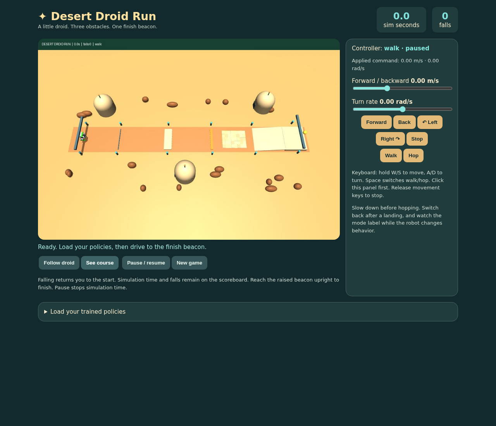
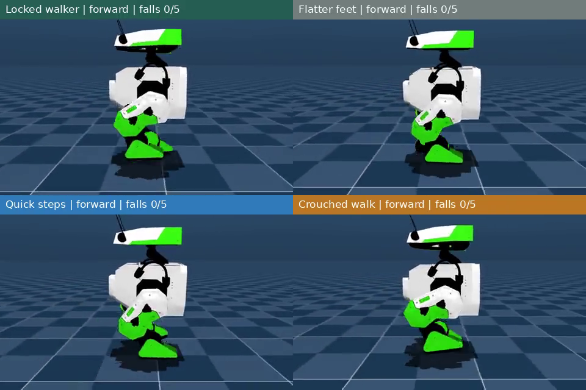

# Teach a little droid to walk

A 163A/263A robotics lesson using **BDX-R + FastSAC + MuJoCo Warp**.
Train, measure, change one parameter, and play a small desert-droid course.



The lesson walks through the actual robot's joints and forward kinematics,
environment configuration, observations, actions, rewards, and SAC. Students
train a controller, change a reward setting, compare measured behavior, and
load their policies into the final interactive course.

**Measured locally:** the scratch walking baseline passed 50 command trials
after about 9 minutes on an L40S. Three scratch-trained variations passed too:
flatter feet, quicker steps, and crouched walking. The hopping curriculum took
about 23 minutes; the recorded course finished in 53.06 simulated seconds with
visual steering and no falls. These are selected results from individual
training seeds, not guaranteed outcomes. **Actual Google Colab execution remains
untested.** See the short [results guide](docs/results.md) for matched-control
caveats and acceptance checks. Detailed timings accompany the lesson recordings.

[](assets/lesson/walking_overview/comparison.mp4)

[Compare the reference and three walking styles](assets/lesson/walking_overview/comparison.mp4).
[Watch the new course run](assets/lesson/course25_run/rollout.mp4) or
[compare the hopping motions](assets/lesson/course_hops/comparison.mp4).

The displayed head gaze is cosmetic; simulated leg motion and physical head
targets are unchanged. A physical neutral-pose correction remains unvalidated.

- [Student notebook](notebooks/BDXR_Walking_101.ipynb)
- [Short instructor notes](docs/instructor_notes.md)
- [Measured results and their limits](docs/results.md)
- [Implementation status](docs/progress.md)

Upload the notebook to Colab and select a GPU runtime. It includes lesson source
and curated recordings, then fetches pinned upstream robot assets. Publishing
this repository is not required.

## What the policy sees

The actor receives joint positions/velocities, body angular velocity, gravity
direction, previous actions, and requested speed/yaw rate. It does not receive
true base linear velocity, world position, absolute heading, or a terrain map.
The training critic may use privileged simulator observations.

The deployed controller follows user commands. There is no planner or external
heading correction. World measurements are used for evaluation and game scoring.

## Repository layout

| Path | Purpose |
| --- | --- |
| `src/bdxr_classroom/simulation/` | Robot environment, commands, terrain, and rewards |
| `src/bdxr_classroom/learning/` | FastSAC, replay symmetry, training, and policy export |
| `src/bdxr_classroom/evaluation/` | Rollouts, command checks, measurements, and plots |
| `src/bdxr_classroom/game/` | Course, controller handovers, scoring, and web interface |
| `src/bdxr_classroom/lesson/` | Notebook execution, visualizations, assessment, and exports |
| `notebooks/` | Portable notebook and readable chapter sources in `sections/` |
| `configs/` | Pinned revisions, evaluation targets, course, and hopping curriculum |
| `assets/lesson/` | Only selected media used by the lesson |
| `scripts/` | Entry points grouped into setup, lesson, training, evaluation, and media |
| `tests/` | Tests grouped by simulation, learning, evaluation, game, lesson, and storage |
| `experiments/lesson/` | **Gitignored** selected policy runs |
| `experiments/candidates/` | New or unfinished training runs |
| `experiments/evaluations/` | Course, obstacle, and controller checks |
| `experiments/support/` | Parent policies and historical media sources |
| `experiments/archive/` | Retired trial evidence and cleanup manifests |

Vendor checkouts, caches, raw results, checkpoints, and private working notes
stay out of new commits. Curated media captions distinguish preliminary results
from selected command policies.
Local results are explained in `experiments/INDEX.md`; its linked catalog records
individual trials. Each run keeps its `<timestamp>_<name>` directory and its
configuration, checkpoints, metrics, and videos together. New training runs go
to `candidates/`; selection requires review of their results.

Edit the teaching cells in `notebooks/sections/`, then rebuild the portable file
with `.venv/bin/python scripts/lesson/build_notebook.py`. It bundles the classroom
code and selected recordings; students do not need access to this private repo.
Instructor figures and short animated examples are Markdown attachments, visible
without executing cells. Student activities generate separate results.

## Local use

```bash
python scripts/setup/setup.py
export PYTHONPATH="$PWD/src"
export MUJOCO_GL=egl
.venv/bin/python -m bdxr_classroom.learning.train \
  --name command_walking --num-envs 512 --batch-size 2048 --seed 7 \
  --steps 10000 --minutes 15 --command-mode balanced \
  --yaw-tracking imu --yaw-std .2 --yaw-bias-weight 6 \
  --lateral-bias-weight 2 --mirror-replay --compile
```

These settings match the notebook's walking recipe. Runtime depends on the GPU;
the time limit can stop training before 10,000 steps. The trainer prints the
actual timestamped experiment path. To evaluate it:

```bash
.venv/bin/python -m bdxr_classroom.evaluation.command_evaluate \
  experiments/candidates/<timestamp>_command_walking/checkpoints/final.pt
python scripts/evaluation/check_command_results.py \
  experiments/candidates/<timestamp>_command_walking/evaluation/final_commands/summary.json
```

Resume with `--resume .../checkpoints/resume.pt`; policy, critics, optimizers,
normalization and replay are restored, while simulation episodes restart.
Use `--finetune` to start a new experiment from a compatible training checkpoint.
Fine-tuning uses the requested seed for a new random stream; resuming restores
the checkpoint's random stream.
W&B is on by default; students can use `--wandb-mode disabled`.

Launch the game with walking and optional hopping checkpoints:

```bash
.venv/bin/python -m bdxr_classroom.game.server \
  --walking experiments/lesson/<walking-run>/checkpoints/final.pt \
  --hopping experiments/lesson/<hopping-run>/checkpoints/<selected-checkpoint>.pt \
  --course-config configs/classroom_course.json \
  --head-motion-config configs/head_motion.json
```

The local panel runs on port 8765. The notebook includes the Colab port-proxy
integration. Falls reset the robot; simulation time and fall count accumulate.
The calibrated course uses three 17.5–25 mm obstacles, rough ground and an
18 cm ascent. Four route checkpoints must be crossed before the finish counts.
Use `--course-config path/to/settings.json` to explore a harder course;
`{"obstacle_scale": 1.0}` doubles the classroom obstacle heights.

## Credits

[BDX-R](https://github.com/BDX-R/BDX-R-MjLab) provides the robot and starting task.
[Holosoma / FastSAC](https://younggyo.me/fastsac-humanoid/) provides the learning
components. The desert outpost is original procedural scenery.
See [third-party notices](THIRD_PARTY_NOTICES.md) and [citation metadata](CITATION.cff).
