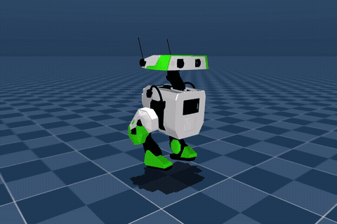

  

# Teach a little droid to walk and hop

| Class | Open directly in Colab |
|---|---|
| **Walking** · train, change one reward, and drive your droid | [Walking class](https://colab.research.google.com/github/TheNewRobot/bdxr-fastsac-classroom/blob/main/notebooks/BDXR_Walking_101.ipynb) |
| **Hopping** · train a hopper and test takeoff and landing | [Hopping class](https://colab.research.google.com/github/TheNewRobot/bdxr-fastsac-classroom/blob/main/notebooks/BDXR_Hopping_Extra.ipynb) |

[Download the walking notebook](notebooks/BDXR_Walking_101.ipynb) · [Watch 15 seconds of gameplay](assets/lesson/classroom_walking/highlights_15s.mp4)

A beginner robotics lesson for **163A/263A**, using **BDX-R, FastSAC, and MuJoCo Warp**. Train a small droid, inspect its motion, and explore how rewards change its gait.

## Start the lesson

**Start with Walking.** Open its Colab link above, save a **fresh copy in Drive**, select a **GPU runtime**, and run the cells in order. Setup downloads the lesson automatically; no manual ZIP upload is needed.

If you saved an earlier version, open the current link and make a fresh copy: older notebooks may contain outdated download checksums that prevent setup from completing. Hopping is a separate optional lesson.

## What you will explore

- Robot joints, forward kinematics, observations, actions, and rewards.
- Walking from scratch, learning curves, and one short walking check.
- Changing one reward, then driving your trained walker through a desert course.
- In the separate hopping class: train one hopper, click Jump, and inspect its landing.

Training targets **12,000 steps**, with a **22-minute cap per run**, excluding setup and display; there
are two runs in the walking lesson. The hopping class trains one stationary
hopper for **6,000 steps** (9.9 minutes in one local L40S run); it needs no walking
checkpoint. Colab hopping timing and reliability remain unverified.

The actor uses proprioception and movement commands; the critic may use additional simulator observations during training.

**Results vary between training runs.** Use the notebook's short checks to
assess your own policy. Local measurements do not guarantee Colab timing or
success. See [measured examples and limitations](docs/results.md).

[Teaching guide](docs/instructor_notes.md) · [Local setup](docs/local_use.md)

## Credits

Robot and starting task: [BDX-R](https://github.com/BDX-R/BDX-R-MjLab). Learning components: [Holosoma / FastSAC](https://younggyo.me/fastsac-humanoid/). See [third-party notices](THIRD_PARTY_NOTICES.md) and [citation metadata](CITATION.cff).
