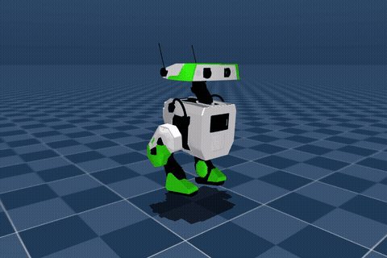

  

# Teach a little droid to walk

**[Open in Google Colab](https://colab.research.google.com/github/TheNewRobot/bdxr-fastsac-classroom/blob/main/notebooks/BDXR_Walking_101.ipynb)** · [Download the notebook](notebooks/BDXR_Walking_101.ipynb) · [Watch 15 seconds of gameplay](assets/lesson/classroom_walking/highlights_15s.mp4)

A beginner robotics lesson for **163A/263A**, using **BDX-R, FastSAC, and MuJoCo Warp**. Train a small droid, inspect its motion, and explore how rewards change its gait.

## Start the lesson

Open the Colab link, save a copy in Drive, select a **GPU runtime**, and run the cells in order. Setup downloads the lesson automatically; no manual ZIP upload is needed.

## What you will explore

- Robot joints, forward kinematics, observations, actions, and rewards.
- Walking from scratch, learning curves, and one short walking check.
- Changing one reward, then driving your trained walker through a desert course.

Training targets **12,000 steps**, with a **22-minute cap per run**, excluding setup and display; there
are two runs in the lesson. Hopping is a [separate after-class extension](notebooks/BDXR_Hopping_Extra.ipynb).

The actor uses proprioception and movement commands; the critic may use additional simulator observations during training.

**Validation:** local L40S checks include successful and unsuccessful fresh runs.
A user-reported Colab T4 run completed 12,000 steps in 1,024 seconds and passed
the 33-second walking check. End-to-end Colab reliability remains unverified.
See the [results](docs/results.md)
and [current measurements](docs/progress.md).

[Instructor notes](docs/instructor_notes.md) · [Local setup and development](docs/local_use.md) · [Walking-only course video](assets/lesson/classroom_walking/course.mp4)

## Credits

Robot and starting task: [BDX-R](https://github.com/BDX-R/BDX-R-MjLab). Learning components: [Holosoma / FastSAC](https://younggyo.me/fastsac-humanoid/). See [third-party notices](THIRD_PARTY_NOTICES.md) and [citation metadata](CITATION.cff).
