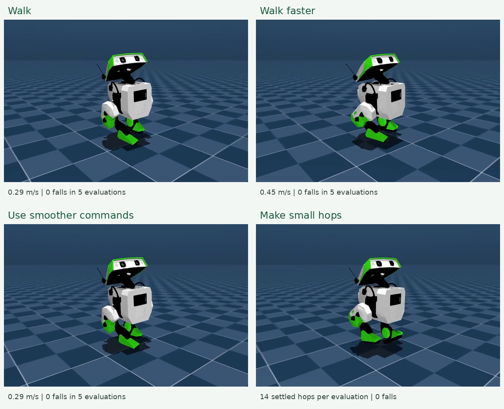

# Teach BDX-R to walk

A robotics 101 lesson using **BDX-R + FastSAC**, designed for Google Colab.



[Walking video](examples/baseline/rollout.mp4) ·
[Slower walking](examples/slower/rollout.mp4) ·
[Faster walking](examples/faster/rollout.mp4) ·
[Smoother commands](examples/smoother/rollout.mp4) ·
[Small hops](examples/hopping/rollout.mp4) ·
[Higher foot-clearance hops](examples/hopping_taller/rollout.mp4) ·
[Side-by-side walking comparison](docs/walking_comparison.mp4)

**Status:** real trained policies, recorded examples, and a self-contained
notebook package. Local GPU and notebook validation are documented below.
Actual execution on Google Colab has not been performed.

- [Class notebook](notebooks/BDXR_Walking_101.ipynb)
- [Original class notebook](ref/25F_163A_263A_BipedalWalker_SeminarRL101.ipynb)
- [Instructor notes](docs/instructor_notes.md)
- [Implementation and validation record](docs/progress.md)
- [Measured results and timings](docs/results.md)
- [Instructor W&B gallery](https://wandb.ai/afloresa/bdxr-fastsac-classroom/runs/mhyyosrc)

Download the notebook and use **File → Upload notebook** in Colab. Select a GPU
runtime. The notebook includes a small source-code bundle and fetches pinned
robot assets, so it does not require this repository to be published first.

It installs dependencies, trains, records videos, plots real measurements, and
fine-tunes one variation. Students can use it without a W&B account.
Recorded examples and compact policies are included in the notebook, so students
can inspect real results before their own training finishes.

## Project layout

| Folder | Contents |
| --- | --- |
| `notebooks/` | Uploadable student lesson |
| `src/bdxr_classroom/` | Simulator adapter, FastSAC, training and evaluation |
| `configs/` | Exact upstream revisions |
| `examples/` | Selected videos, measured curves and small inference policies |
| `scripts/` | Setup, reproducible comparisons and notebook packaging |
| `tests/` | Simulation and learning contract checks |
| `docs/` | Results and short instructor notes |
| `ref/` | Preserved original class notebook |

Large training checkpoints, caches, local logs and the private plan are
gitignored. The small, deliberate example assets are versioned so the lesson
remains easy to review and upload.

## Local use

```bash
python scripts/setup.py
export PYTHONPATH="$PWD/src"
export MUJOCO_GL=egl
.venv/bin/python -m bdxr_classroom.train --name my_walk --compile
.venv/bin/python -m bdxr_classroom.evaluate runs/my_walk/final.pt
.venv/bin/python -m bdxr_classroom.plots runs/my_walk
```

Training uses W&B by default. Add `--wandb-mode disabled` for local-only logging.
The default project is `bdxr-fastsac-classroom`.

Continue the same experiment with `--resume runs/my_walk/resume.pt`. Use the
same environment count and configuration. The checkpoint contains replay,
optimizer, policy, critic, and normalization state; simulated episodes restart.
Use `--finetune` with a training checkpoint such as `step_006000.pt` to start
a new behavior experiment without carrying over replay transitions. The small
`examples/*/policy.pt` exports support evaluation only.

To reproduce the three walking variations and an unchanged control from one parent:

```bash
.venv/bin/python scripts/run_walking_comparisons.py runs/walk_02/step_006000.pt
```

Each variation changes one setting and starts from that same checkpoint.
The control keeps settings unchanged with the same extra training budget.
See the example provenance files for the exact recorded configurations.

## Learning goals

Identify observations, actions, and rewards; explain the policy's role; watch
learning change robot motion; compare one controlled experiment using video,
speed, and joint-angle measurements.

## Credits

- [BDX-R](https://github.com/BDX-R) and its
  [mjlab integration](https://github.com/BDX-R/BDX-R-MjLab): robot and reference video.
- [FastSAC project](https://younggyo.me/fastsac-humanoid/): intended training approach.

The selected walking, slower, faster, smoother, and both hopping policies each passed five
15-second evaluations with small starting-pose perturbations and no falls.
The baseline averages 0.291 m/s, faster walking 0.445 m/s, and the smoother
variant reduces command changes by about 15% while retaining baseline speed.
The hopping example produces small, repeated flights and stable landings.

These are local L40S simulation results, not Colab timing guarantees or
real-robot deployment validation. The upstream reference video is credited
separately from our trained results.

See [third-party notices](THIRD_PARTY_NOTICES.md) for attribution.
Citation metadata for this teaching project is provided in [CITATION.cff](CITATION.cff).
