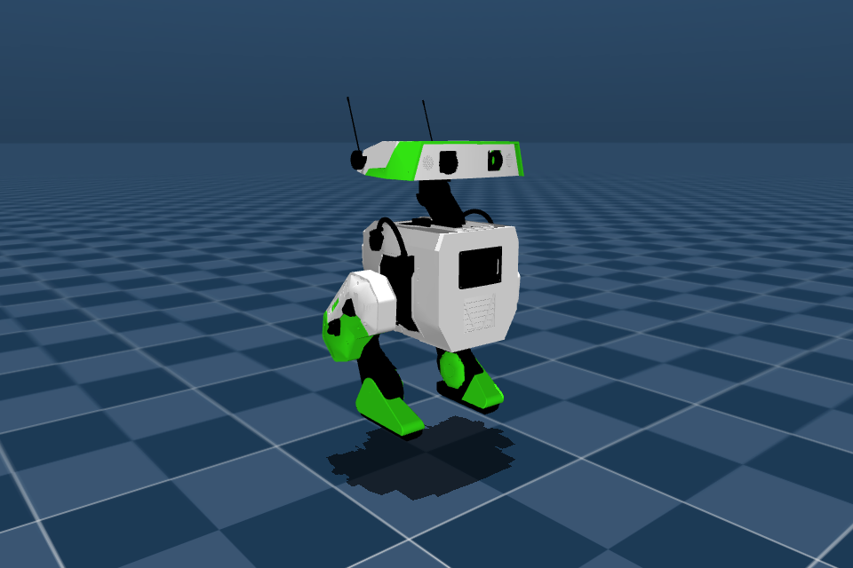

  

# Teach a little droid to walk

**[Open in Google Colab](https://colab.research.google.com/github/TheNewRobot/bdxr-fastsac-classroom/blob/main/notebooks/BDXR_Walking_101.ipynb)** · [Download the notebook](notebooks/BDXR_Walking_101.ipynb) · [Watch the 15-second demo](assets/lesson/course25_run/highlights_15s.mp4)

A beginner robotics lesson for **163A/263A**, using **BDX-R, FastSAC, and MuJoCo Warp**. Train a small droid, inspect its motion, and explore how rewards change its gait.

## Start the lesson

Open the Colab link, save a copy in Drive, select a GPU runtime, and run the cells in order. Setup downloads the lesson automatically; no manual ZIP upload is needed.

## What you will explore

- Robot joints, forward kinematics, observations, actions, and rewards.
- Walking from scratch, learning curves, and checkpoint evaluation.
- Changing one reward to compare gaits, with optional hopping and an interactive obstacle course.

The actor uses proprioception and movement commands; the critic may use additional simulator observations during training.

**Validation:** selected policies passed local L40S checks. Colab's teaching media have been checked, but **full GPU execution in Colab remains unvalidated**. Training outcomes and timings can vary. See the [results](docs/results.md) and [latest validation notes](docs/progress.md).

[Instructor notes](docs/instructor_notes.md) · [Local setup and development](docs/local_use.md) · [Compare walking styles](assets/lesson/walking_overview/comparison.mp4)

## Credits

Robot and starting task: [BDX-R](https://github.com/BDX-R/BDX-R-MjLab). Learning components: [Holosoma / FastSAC](https://younggyo.me/fastsac-humanoid/). See [third-party notices](THIRD_PARTY_NOTICES.md) and [citation metadata](CITATION.cff).
