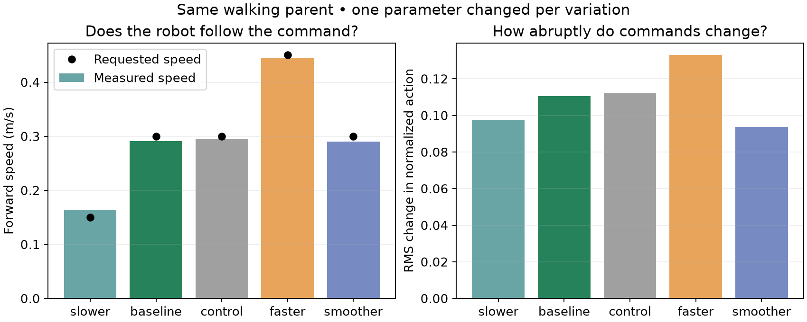

# Measured classroom examples

All results below use the complete BDX-R model, the FastSAC classroom adapter,
and MuJoCo Warp on an NVIDIA L40S. Each selected policy was evaluated for five
15-second episodes with different seeds, initial yaw variation, and joint and
roll/pitch perturbations of up to 0.015 radians.

| Example | Target speed | Measured mean speed | Falls | Training to selected checkpoint |
| --- | --- | --- | --- | --- |
| Walking | 0.30 m/s | 0.291 m/s | 0/5 | 5.3 min from scratch |
| Unchanged control | 0.30 m/s | 0.295 m/s | 0/5 | 1.5 min additional training |
| Slower walking | 0.15 m/s | 0.164 m/s | 0/5 | 2.0 min additional fine-tuning |
| Faster walking | 0.45 m/s | 0.445 m/s | 0/5 | 2.4 min additional fine-tuning |
| Smoother commands | 0.30 m/s | 0.291 m/s | 0/5 | 2.0 min additional fine-tuning |
| Small hops | Stationary | About 0.009 m/s drift | 0/5 | 3.8 min additional fine-tuning after tiny-hop training |
| Higher foot-clearance hops | Stationary | About 0.022 m/s drift | 0/5 | 2.6 min additional fine-tuning |

All three walking variations start from the **same 6,000-step walking checkpoint**.
The smoother variant triples the action-change penalty. Its mean per-step
action-change RMS is 0.094 versus 0.111 for the parent: about **15% lower**.
This measures motor-command changes, not energy consumption.

The unchanged control starts from the same parent with the same 2,000 extra
training steps and fresh replay. Its action-change RMS is 0.112, so the
smoother variant is also about **16% lower than this matched-budget control**.
These are descriptive results from the recorded runs, not a multi-seed
statistical claim.



[Watch the synchronized walking comparison](walking_comparison.mp4).
The behaviors use one training seed each; evaluation seeds perturb the starting
pose rather than independently repeating training.

The hopping policy produces **14 settled hops per evaluated episode** after
the first second. A counted hop requires both feet to lose contact with
measurable clearance, then at least 0.15 seconds of upright two-foot contact.
Rebounds before settling are not counted as separate stable landings.

The hop training is two-stage: 4,000 steps of tiny-hop training (about 5.1 min
in the recorded run), followed by 3,000 steps with a larger foot-height target
and an added body-height objective (about 3.8 min). These are small hops;
the requested height is not a claim about achieved body rise.

A further single-parameter experiment changes the hop target from 0.07 to
0.10 m while holding the body-height reward weight fixed at 6. Its measured
peak simultaneous foot clearance is about 9.2 cm versus 6.3 cm for its parent.
It also produces 14 settled hops in each evaluation. The body still makes a
small bounce: feet rising is not the same as the body jumping that distance.
[Watch this variation](../examples/hopping_taller/rollout.mp4).

## Timings and scope

Times are measured wall time with a **warm simulator cache**; some jobs shared
the GPU with other experiments. They include training-loop compilation and
periodic saves but exclude dependency installation and video rendering.
They are not isolated GPU benchmarks or Colab timing guarantees.

An earlier walking checkpoint, at 3,000 steps, already completed five
10-second evaluations at about 0.27 m/s after approximately 151 seconds.
The selected parent uses additional training.

The 512-environment preset was independently trained with seed 7. Its
4,000-step checkpoint also passed five perturbed-start 15-second evaluations
at about 0.293 m/s with no falls. A seed-42 diagnostic learned more slowly
in this smaller configuration; the notebook therefore uses the measured
seed-7 preset.

These tests establish useful simulation examples, not comprehensive robustness
or physical-robot deployment readiness. Actual execution on Google Colab has
not been performed; local notebook execution is documented separately.

## Files and reproduction

Each directory under `examples/` includes:

- `rollout.mp4`: the first evaluated episode.
- `motion.png`: measured motion and joint trajectories.
- `learning_curves.png` and `metrics.jsonl`: real training measurements.
- `evaluation.json`: every evaluation episode.
- `provenance.json`: exact source checkpoint, configuration, and timing.
- `policy.pt`: compact **inference-only** actor and normalization state.

The larger local `runs/*/resume.pt` files include replay and optimizer state.
Selected training checkpoints are also uploaded to the instructor W&B project,
without the replay buffer. Resuming those checkpoints restarts replay and
simulation episodes; it is not bit-for-bit continuation.

To render the compact baseline after setup:

```bash
PYTHONPATH=src MUJOCO_GL=egl .venv/bin/python -m bdxr_classroom.evaluate examples/baseline/policy.pt
```

For exact training settings, use the `config` object in each example's
`provenance.json`. The notebook provides the beginner-friendly route.

With access to the instructor W&B project, retrieve the walking training
checkpoint and reproduce the matched-budget comparisons:

```bash
.venv/bin/python -c 'import wandb; wandb.Api().artifact("afloresa/bdxr-fastsac-classroom/bdxr-walk_02:classroom").download(root="runs/pretrained_walk")'
.venv/bin/python scripts/run_walking_comparisons.py runs/pretrained_walk/checkpoint.pt
```

[W&B classroom gallery and selected checkpoints](https://wandb.ai/afloresa/bdxr-fastsac-classroom/runs/mhyyosrc)
